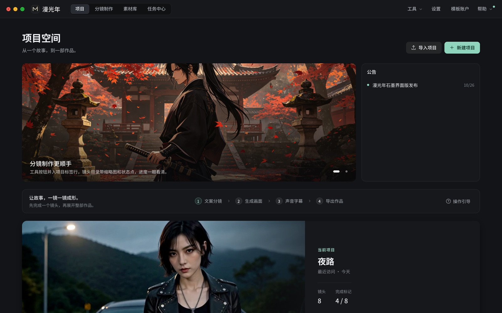
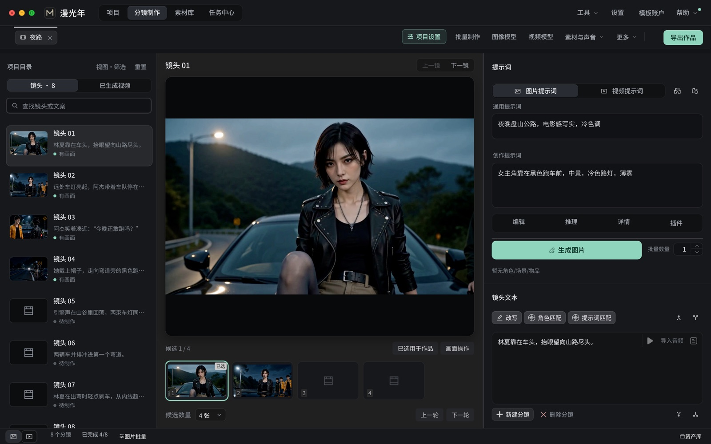
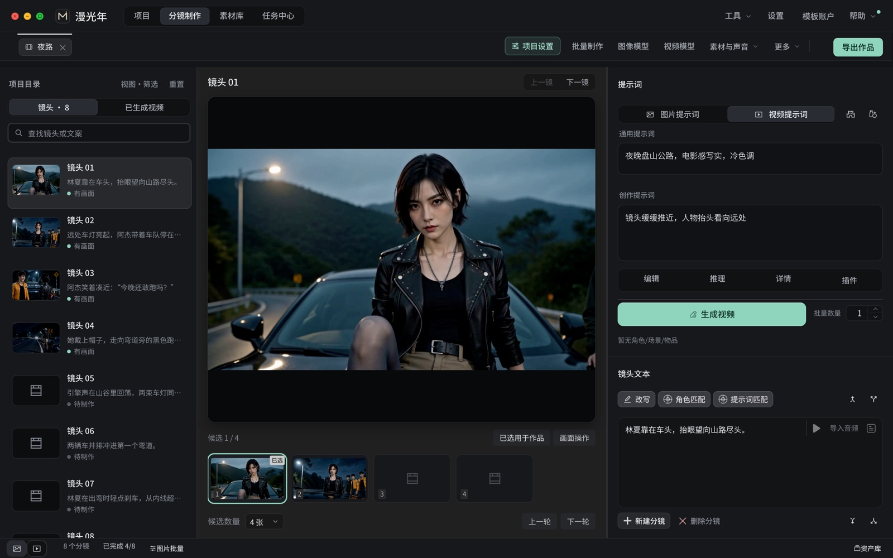
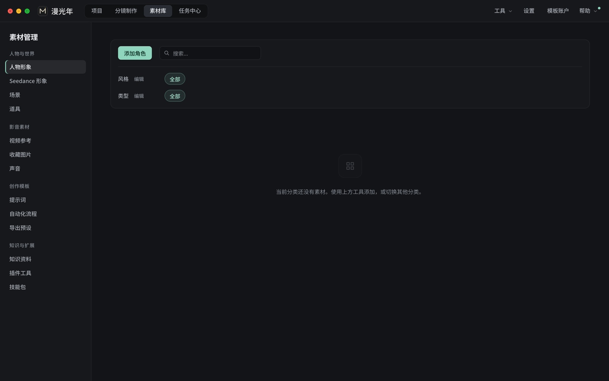

# 漫光年 MANLIGHT

**从一个故事，到一部作品。**

AI 漫剧与短剧分镜创作工作台：文案分镜 → 生成画面 → 声音字幕 → 导出作品

> 本仓库是漫光年的项目主页，用于发布更新说明和收集反馈，不包含软件源码和安装包。
> 安装器只在官网提供：[down.lrmj.site](https://down.lrmj.site/manlight-download/)

## 界面预览

<table>
<tr>
<td width="50%"></td>
<td width="50%"></td>
</tr>
<tr>
<td align="center">视频提示词与生成</td>
<td align="center">人物、场景与素材库</td>
</tr>
</table>

## 主要功能

- **文案智能分镜**：粘贴文案或导入 SRT，自动切词分镜，可继承上个作品的角色、场景和物品
- **画面生成与选用**：每镜多张候选、多轮生成，选用后进入成片
- **视频生成**：通过自己的云端 ComfyUI 生成视频，内置 AutoDL 与直连实例两个插件
- **人物与场景一致性**：统一的名称、描述和参考图，跨镜头保持角色一致
- **项目设置与推理模板**：推理、改写、角色匹配模板集中管理；云端加密模板按需登录使用
- **配音、字幕与后期**：在项目内完成，导出时统一合成
- **批量制作与任务中心**：单镜确认后批量处理整部作品，任务进度与错误集中查看
- **智能协作**：软件内对话，也可让 Codex、WorkBuddy 通过 MCP 读取和修改项目

## 下载与安装

| 项目 | 说明 |
| --- | --- |
| 系统 | Windows 10 / 11（64 位） |
| 磁盘 | 安装约需 3.1 GB 可用空间 |
| 下载 | [官网下载页](https://down.lrmj.site/manlight-download/) |
| 升级 | 同一个安装器，选择原安装目录即可升级，保留项目和配置 |
| 登录 | 工作台和普通模板无需登录；加密模板需登录中转站 |

模型 API：语言模型和漫光年图片插件已预设中转站地址，前往 [lrmj.site](https://lrmj.site) 获取密钥后填写即可。

## 教程

- [视频与图文教程](https://down.lrmj.site/manlight-tutorial/)
- [安装与入门](https://down.lrmj.site/getting-started/)

## 反馈与交流

- 提交问题：在本仓库 [Issues](../../issues) 中描述页面、操作步骤和错误提示，截图请遮挡 API Key 与个人信息
- QQ 群：**225951167**（安装与账户咨询）
- 合作联系：QQ **1284536496**

---

© 2026 漫光年 MANLIGHT

